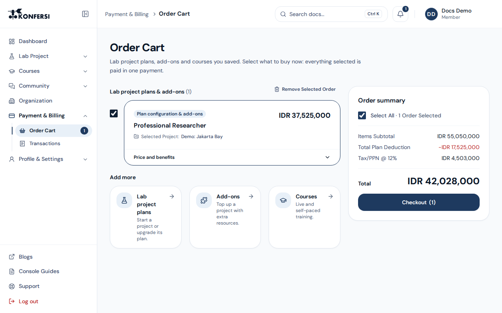
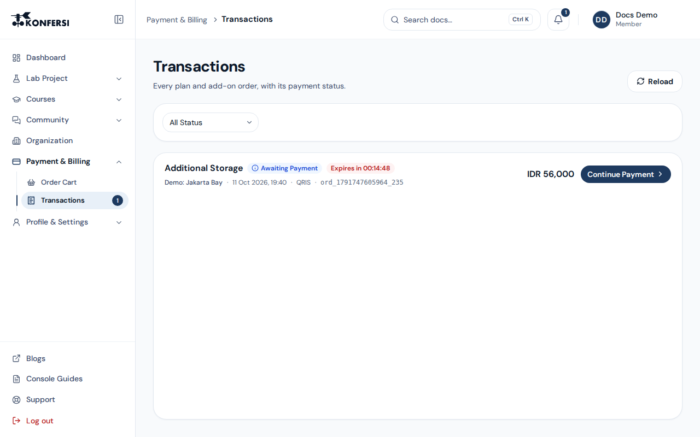

Both pages are under **Payment & Billing** in the Console side menu. The menu shows how many items are waiting in your cart.

## Order Cart

The **Order Cart** keeps what you saved to pay for later:

- **Lab project plans & add-ons** you configured under **Lab Project → Project Plan** or **Lab Project → Add-ons**
- **Course tickets** you saved with **Save to cart, pay later** (see [Courses](../using-konfersi/courses.md))

Everything you select is paid in one payment. Everything in a checkout is priced in your billing currency (see [Plans & pricing](plans-and-pricing.md#your-billing-currency)).

### Pay for plans and add-ons

1. Tick the orders you want to pay for, or **Select All**.
2. Check the **Pricing Details**: item subtotal, any discount or plan deduction, and tax (PPN).
3. Select **Checkout**, choose a payment method, and finish paying. See [Payments](payments.md).

To remove orders, tick them and select **Remove Selected Order**, then confirm. If an order's details are incomplete, the cart skips it and tells you; remove it and create it again.

## Transactions

**Transactions** lists every plan and add-on order with its payment status. Select **Load more** to see more.

- **Continue Payment** reopens a pending payment before it expires; the countdown shows how long is left.
- **View Details** opens the order with its items, amounts and status.

For what each status means, see [Payments](payments.md#payment-and-order-statuses). Course enrolments are tracked in **Courses → My Courses** instead.
