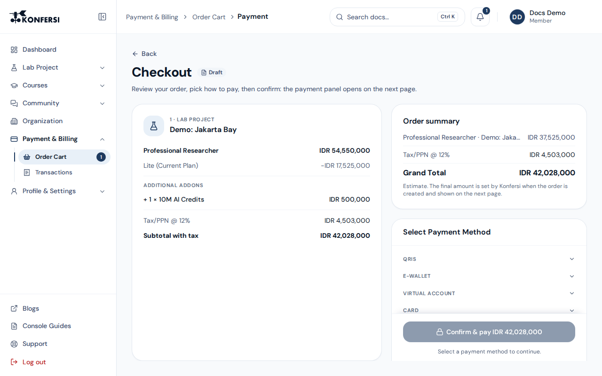

Konfersi takes payments through **Midtrans**, an Indonesian payment gateway. You pay on a Midtrans payment screen, and Konfersi is told the result directly by Midtrans. This page explains the steps, the payment methods and what each status means.

## Paying for a plan or add-on in the Console

1. In the [Console](../using-konfersi/console-projects.md), open **Lab Project → Project Plan** and choose a plan, with extra resources under add-ons, or buy add-ons alone under **Lab Project → Add-ons**. You can collect several orders in the [Order Cart](order-cart-and-transactions.md) first.
2. Review the breakdown: plan price, any add-ons, subtotal, tax (PPN) and grand total. See [Plans & pricing](plans-and-pricing.md) for how prices and currency work.
3. Select a payment method and choose **Confirm & pay**.
4. The payment panel opens on the next page. Finish the payment there, for example by scanning the QR code or paying the virtual account number from your bank.
5. When Midtrans confirms the payment, your order is marked **Completed**. The plan or add-on resources are applied to your project automatically.

You pay in your account's **billing currency**, which is the currency every price in the Console is shown in (see [Plans & pricing](plans-and-pricing.md#your-billing-currency)). Midtrans takes payments in **Indonesian Rupiah (IDR)**. Payment in other currencies, such as USD, isn't available yet: checkout shows **Payment in USD is not available yet. Contact support to complete this order.**, no order is charged, and our team can arrange the purchase with you.

## Supported payment methods

| Method | How you pay |
|---|---|
| **Credit/debit card** | Visa, Mastercard, JCB or American Express, entered on the Midtrans card form |
| **ATM / bank transfer (Virtual Account)** | Pay a virtual account number from your bank's ATM, mobile or internet banking |
| **QRIS / e-wallet** | Scan a QRIS code with GoPay or another QRIS-compatible e-wallet or banking app |

A few things to know:

- Each method has its own minimum and maximum transaction amount. If an order falls outside the range for a method, choose a different one.
- Card details are entered with Midtrans, not with Konfersi. If you save a card for later, Konfersi keeps only a Midtrans card token and a masked card number, never your full card number.
- Pending payments expire if they aren't completed in time. The **Transactions** page shows a countdown for pending orders.

## Payment and order statuses

Track your orders in **Payment & Billing → Transactions**. You'll see these statuses:

| Status in the Console | What it means | What to do |
|---|---|---|
| **Awaiting Payment** | The order exists and is waiting for your payment | Finish paying with **Continue Payment** (or, where offered, switch to another payment method) |
| **Completed** | Midtrans confirmed the payment and your resources were applied | Nothing, you're all set |
| **Failed** | The payment was declined or failed | Place a new order, if needed with a different method |
| **Expired** | The payment window closed before you paid | Place a new order |
| **Canceled** | The order was canceled before payment | Place a new order if you still want it |

An order that failed, expired or was canceled can't be resumed. Create a new order instead. You are not charged for it.

## Paying for a course

You enrol in a course from **Courses → Marketplace** in the Console (see [Courses](../using-konfersi/courses.md)). A course you enrol in from the Marketplace is paid in its own checkout, also powered by Midtrans. A course ticket you saved to the [Order Cart](order-cart-and-transactions.md) can be paid together with plans and add-ons. After you fill in the enrolment form, you are sent to a Midtrans payment page. The methods offered there are the ones Midtrans enables for that checkout. Once your payment is confirmed, the course team sends your registration confirmation by email.

## How payment results reach Konfersi

- Midtrans sends Konfersi a payment notification for every status change. Konfersi checks the notification's cryptographic signature before acting on it, so a forged "paid" message is rejected.
- Resources are only applied once Midtrans reports the payment as settled or captured.
- If you closed the payment window, your order may still show **Awaiting Payment** until Midtrans sends a final result. Check **Transactions** again after a few minutes.

## Invoices and receipts

The **Transactions** page is your record of each order, showing its order ID, items, amounts and status. If your organisation needs a formal invoice or tax document, email [support@konfersi.com](mailto:support@konfersi.com) with your order ID.

## Something went wrong?

If you were charged but your order doesn't show **Completed**, or you see a duplicate charge, contact [support@konfersi.com](mailto:support@konfersi.com). Include:

- your order ID (it starts with `ord_` and is shown on the payment page and in **Transactions**)
- the email address of your Konfersi account
- the payment method and the date and time you paid
- a screenshot of your bank or e-wallet confirmation, if you have one

For refunds, see [Refunds & cancellation](refunds-and-cancellation.md).
