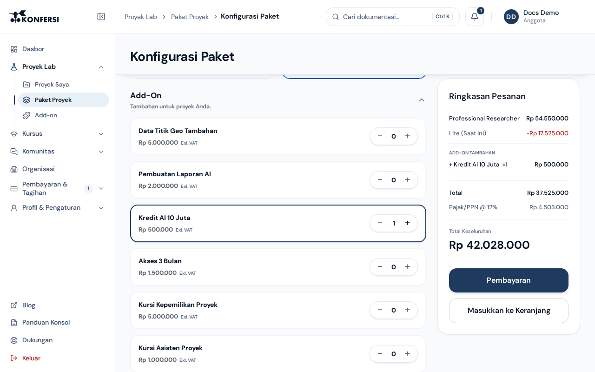
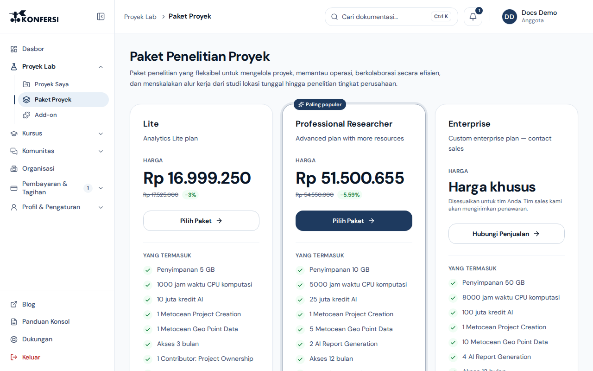
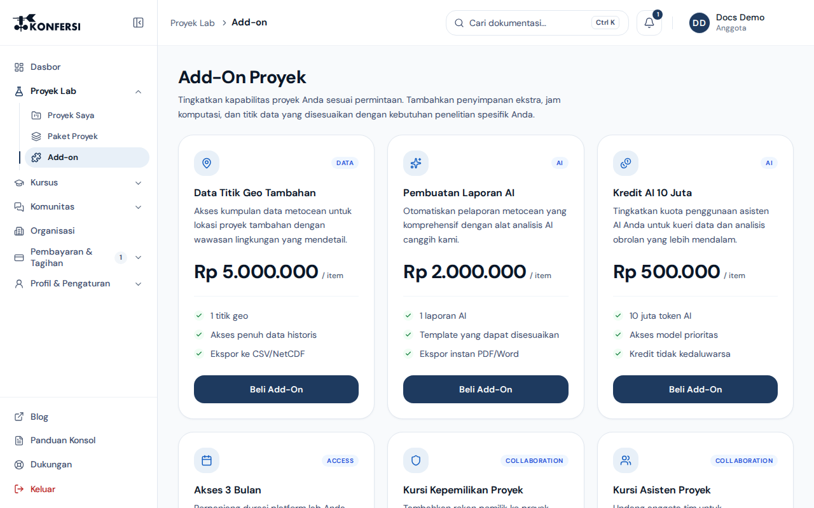

Paket Konfersi disusun berdasarkan seberapa banyak Anda menggunakan platform: komputasi Lab, penyimpanan, kredit AI, dan akses ke fitur Metocean Analytics. Halaman ini menjelaskan tiap tingkatan paket, cara kerja paket dan add-on di Console, serta tempat Anda dapat melihat harga terkini.

<scalar-callout type="info">Harga masih dalam tahap finalisasi. Nama paket dan fitur di bawah ini mencerminkan posisi tiap tingkatan saat ini. Paket dan harga yang berlaku selalu ditampilkan di Console, jadi periksa di sana sebelum membeli.</scalar-callout>

## Tiga tingkatan paket

| Tingkatan | Untuk siapa | Yang ditawarkan |
|---|---|---|
| **Akademik & Riset** | Pelajar, peneliti individu, dan akademisi yang mengeksplorasi data oseanografi | Selalu gratis. Dataset BGC-Argo publik dasar, platform pembelajaran komunitas, 10 jam/bulan komputasi Lab sandbox, dukungan komunitas, lisensi non-komersial |
| **Profesional & Proyek** | Konsultan teknik, tim penyaring lokasi, dan proyek lepas pantai skala kecil hingga menengah | Suite lengkap Metocean Analytics, model angin dan gelombang resolusi tinggi, 100 jam/bulan Lab dan komputasi, unduhan data hindcast ERA5, dukungan email pada hari kerja berikutnya |
| **Perusahaan & Operasi** | Operator besar, instansi pemerintah, dan operasi maritim multi-lokasi | Komputasi cloud khusus, integrasi API dan pipeline kustom, serta lisensi hukum dan data kustom. Disesuaikan melalui proposal |

Untuk **Perusahaan & Operasi**, hubungi kami untuk mendapatkan proposal khusus. Cakupan layanan, ketentuan dukungan, dan lisensi disepakati secara tertulis dengan organisasi Anda. Lihat [Hubungi tim bantuan](../support/contact-support.md).

Kursus (Konfersi Course Series, Web Series, dan Private Course) dijual terpisah dari paket platform. Lihat [Pengembalian dana & pembatalan](refunds-and-cancellation.md) untuk mengetahui cara penanganan pembelian kursus.

## Cara kerja paket di Console

Paket berlaku **per proyek**, bukan per akun. Setiap proyek yang Anda buat di [Console](../using-konfersi/console-projects.md) memiliki paket dan kuota sumber dayanya sendiri.

- **Proyek baru** otomatis menggunakan paket gratis. Anda juga dapat memilih paket berbayar saat membuat proyek.
- **Upgrade** memindahkan proyek ke paket yang lebih tinggi. Console tidak mengizinkan Anda membeli paket yang sedang digunakan proyek tersebut.
- **Add-on** menambah satu jenis sumber daya pada sebuah proyek, misalnya penyimpanan atau kredit AI tambahan, tanpa mengubah paketnya.

Setiap paket dan add-on memberikan sejumlah sumber daya tertentu:

| Sumber daya | Kegunaan |
|---|---|
| Penyimpanan (Storage) | Ruang penyimpanan cloud untuk berkas proyek Anda, dalam GB |
| Komputasi (Compute) | Kredit komputasi untuk menjalankan analisis dan beban kerja Lab |
| Kredit AI | Kredit yang digunakan oleh fitur berbasis AI |

Setelah pembayaran selesai, sumber daya dari paket atau add-on otomatis ditambahkan ke kuota proyek.

## Tempat mengelola paket

Di menu samping Console:

| Menu | Kegunaan |
|---|---|
| **Proyek Lab → Paket Proyek** | Membandingkan paket dan memilih paket untuk sebuah proyek, beserta add-on bila perlu |
| **Proyek Lab → Add-on** | Membeli sumber daya tambahan untuk sebuah proyek tanpa mengubah paketnya |
| **Pembayaran & Tagihan → Keranjang Pesanan** | Meninjau beberapa pesanan paket atau add-on sebelum membayar |
| **Pembayaran & Tagihan → Transaksi** | Memantau status pesanan dan melanjutkan pembayaran yang tertunda |

Lihat [Keranjang pesanan & transaksi](order-cart-and-transactions.md).

## Melihat paket di situs web Konfersi

Halaman **Harga** di situs web Konfersi (pilih **Harga** di bilah atas) menampilkan paket dan harga yang sama dengan di Console, langsung dari katalog paket yang sama. Anda tidak perlu akun untuk melihatnya.

- Setiap paket menampilkan harganya, atau **Gratis**, atau **Harga khusus**, beserta isinya, seperti jam komputasi, penyimpanan, dan kredit AI.
- Harga ditampilkan dalam **satu mata uang**. Jika Anda masuk, itu adalah mata uang tagihan akun Anda. Jika belum masuk, itu adalah mata uang untuk negara tempat Anda membuka situs, yang dideteksi dari koneksi Anda, bukan dari bahasa situs. Catatan di bawah daftar paket menyebutkan PPN yang ditambahkan saat checkout.
- **Mulai** membuka halaman **Paket Proyek** di Console. Jika belum masuk, Anda membuat akun terlebih dahulu (lihat [Membuat akun](../getting-started/create-account.md)). Setelah Anda memverifikasi email di browser yang sama dan melengkapi profil, Konfersi langsung membawa Anda ke halaman tersebut.
- **Hubungi sales** (pada paket dengan harga khusus) membuka permintaan dukungan di Console dengan nama paket sudah terisi. Masuk terlebih dahulu jika diminta.

Harga yang Anda bayar selalu yang tampil saat checkout di Console.

## Mata uang, pajak, dan harga terkini

- **Harga terkini ditampilkan di Console saat checkout.** Dokumentasi ini sengaja tidak mencantumkan angka karena harga dapat berubah.

### Mata uang tagihan Anda

- **Setiap akun memiliki satu mata uang tagihan**, yang ditetapkan otomatis saat Anda membuat akun berdasarkan negara yang Anda isi. Misalnya, Indonesia, Malaysia, dan Singapura ditagih dalam **Rupiah (IDR)**. Semua harga di Console tampil dalam mata uang tersebut, tanpa konversi dan tanpa pilihan untuk mengganti mata uang.
- Profil Anda menampilkannya sebagai **Mata uang tagihan**. Mengubah negara di profil kemudian **tidak** mengubahnya. Untuk menggantinya, [hubungi dukungan](../support/contact-support.md); setiap perubahan dicatat.
- Jika Anda mendaftar dengan Google, Microsoft, GitHub, atau login organisasi Anda dan belum mengisi negara, isi negara di profil Anda sebelum checkout. Checkout tidak dapat dilanjutkan tanpa negara.
- Akun yang dibuat sebelum mata uang per akun diberlakukan tetap memakai **IDR**, seperti yang ditagihkan sebelumnya.
- Saat Anda membeli untuk **organisasi**, harganya mengikuti mata uang tagihan pengelola tagihan organisasi (pemilik, kecuali pemilik menunjuk orang lain).

### Harga dalam setiap mata uang

- Konfersi menetapkan harga setiap paket, add-on, dan tiket kursus **secara terpisah untuk setiap mata uang**. Harga tidak dikonversi dari IDR dengan kurs, sehingga nominal yang Anda lihat adalah nominal yang ditagihkan.
- Jika suatu item tidak memiliki harga dalam mata uang Anda, yang tampil adalah harganya dalam mata uang utama Konfersi. Jika keduanya tidak ada, item tersebut menampilkan **Tidak tersedia di wilayah Anda — hubungi kami**, dan Anda dapat [menghubungi tim penjualan](../support/contact-support.md).
- Pesanan tetap memakai mata uang dan nominal saat pesanan dibuat, meskipun harga berubah kemudian. Satu pesanan atau checkout selalu dalam satu mata uang.

### Pembayaran dan pajak

- Pembayaran dalam **IDR** diproses melalui mitra pembayaran kami, Midtrans (lihat [Pembayaran](payments.md)).
- **Pembayaran dalam mata uang lain, seperti USD, belum tersedia.** Jika mata uang tagihan Anda salah satunya, checkout menampilkan **Pembayaran dalam USD segera hadir — hubungi kami**, dan tidak ada yang ditagihkan. Hubungi kami dan kami akan mengatur pembelian Anda.
- Pajak Pertambahan Nilai (PPN) ditambahkan di atas subtotal. Rincian checkout menampilkan subtotal, pajak, dan total akhir sebelum Anda membayar.

Untuk mengetahui cara pembayaran, lihat [Pembayaran](payments.md).

## Pertanyaan seputar paket

- Membutuhkan sesuatu di luar tingkatan yang ada, seperti komputasi lebih besar atau lisensi kustom? Tanyakan tentang paket Perusahaan & Operasi melalui [Hubungi tim bantuan](../support/contact-support.md).
- Untuk cara Konfersi dapat menggunakan data proyek Anda, lihat [Kebijakan Privasi](../legal/privacy.md). Untuk ketentuan kontrak yang berlaku bagi paket berbayar, lihat [Ketentuan Layanan](../legal/terms.md).
