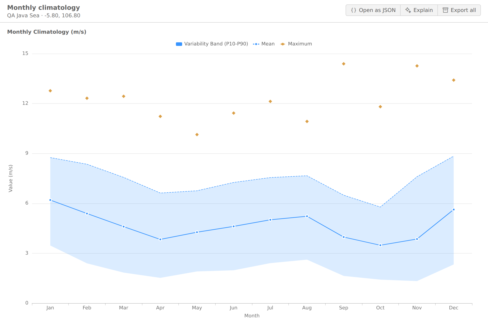
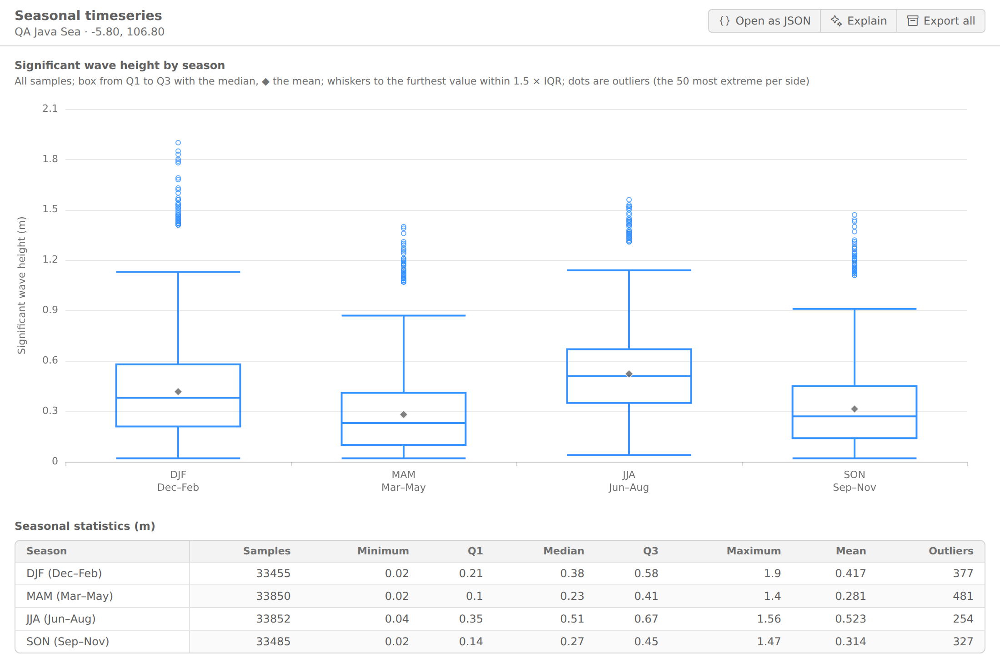
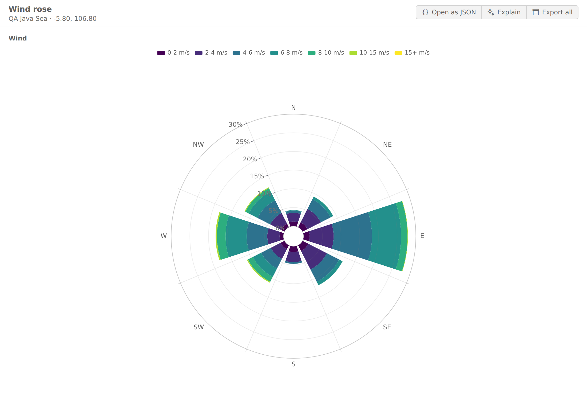
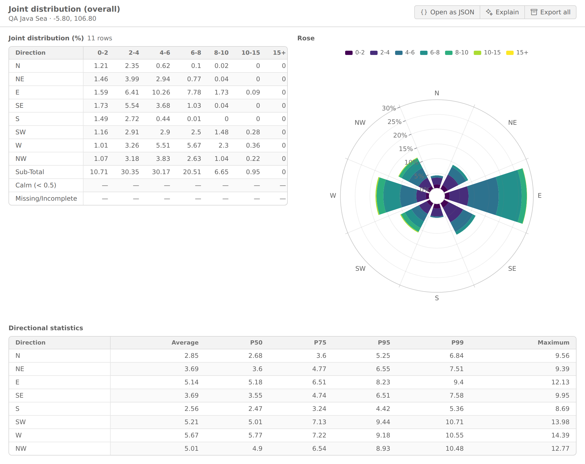
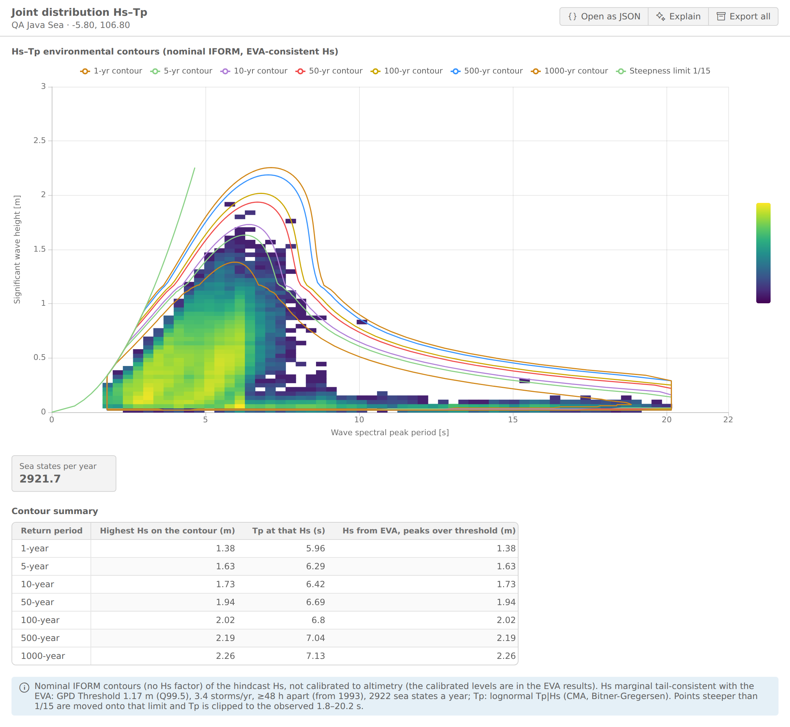
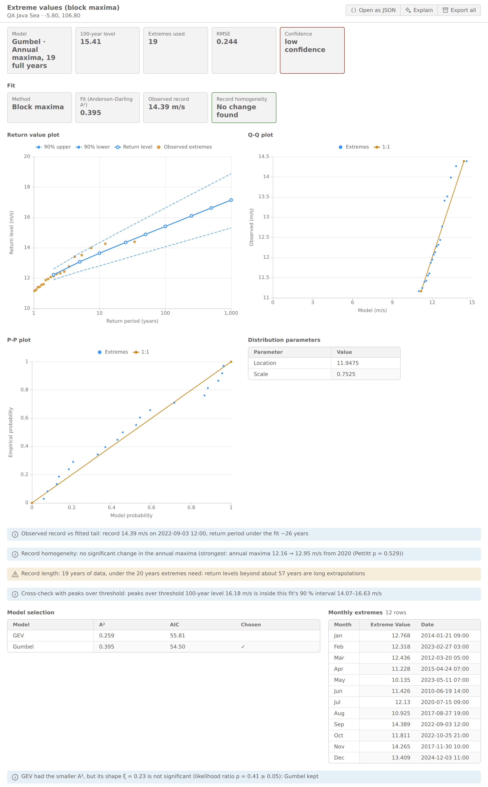
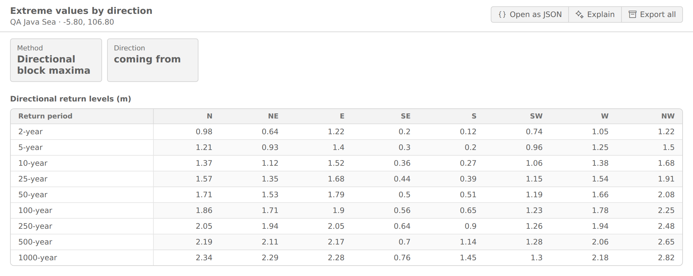
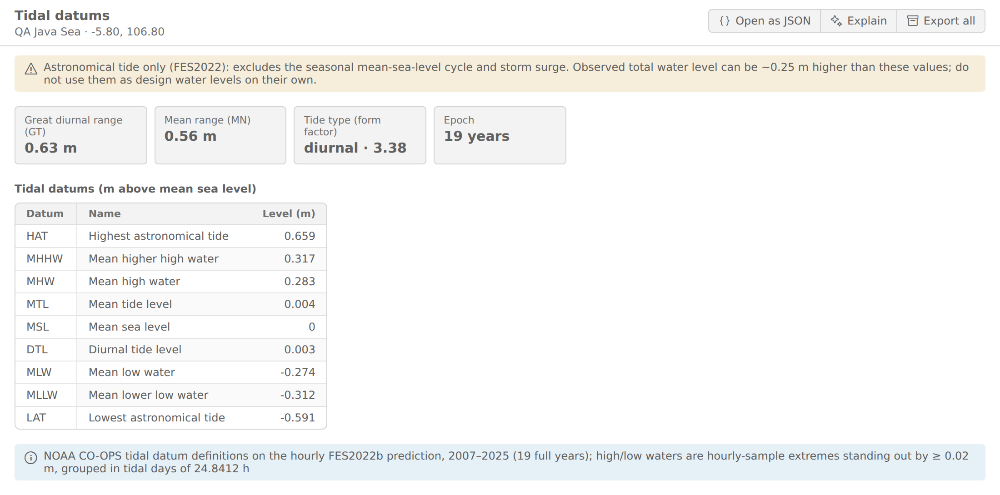
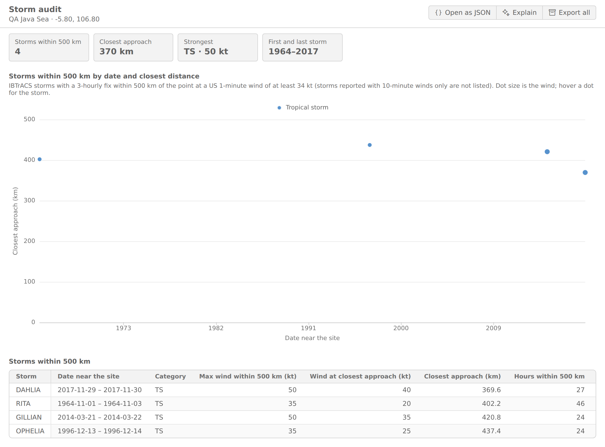

Saat Anda [memproses titik](../points/process-points.md), Lab mengunduh rekaman setiap variabel untuk titik itu, memeriksa kualitasnya, lalu menjalankan serangkaian analisis. Halaman ini menjelaskan cara membaca setiap analisis. Asal setiap variabel, beserta rekaman dan resolusinya, ada di [Variabel & sumber](../data/variables-and-sources.md); cara membuka dan mengekspor grafik ada di [Analisis & grafik](index.md).

## Cara titik diproses

- **Sel laut terdekat.** Setiap dataset berbentuk grid. Hasil dibaca dari sel grid terdekat dengan titik Anda yang memiliki data laut. Jarak ke sel itu ikut diperiksa: lebih dari 30 km diberi peringatan, lebih dari 75 km dinyatakan gagal.
- **Kontrol kualitas.** Setiap rekaman diperiksa untuk nilai di luar batas fisik, nilai yang datar terlalu lama, lonjakan satu langkah yang terisolasi, celah data, dan kelengkapan (peringatan di bawah 99 %, gagal di bawah 90 %). Untuk gelombang, lonjakan terisolasi dibuang sebelum analisis, karena reanalisis gelombang memiliki artefak satu langkah yang diketahui dan bisa menjadi nilai rekor atau ekor ekstrem.
- **Tiga kondisi.** Setiap analisis tersedia untuk **Semua kondisi**, **Hanya siklonik**, dan **Hanya non-siklonik**. Periode siklonik adalah tanggal-tanggal ketika siklon tropis (dari catatan IBTrACS) berada dalam 500 km dari titik, ditambah 2 hari di setiap sisinya. Jika tidak ada siklon yang sedekat itu, *Hanya siklonik* kosong dan *Hanya non-siklonik* berisi seluruh rekaman. Muka air tidak dibagi per kondisi siklon.
- **Versi analisis.** Hasil membawa versi pipeline analisis yang membuatnya. Saat metodenya berubah, Lab memproses titik itu lagi saat Anda memakainya berikutnya.

## Catatan yang mengubah cara membaca hasil

Beberapa variabel membawa catatan yang tampil bersama setiap hasilnya. Catatan ini tercantum per variabel di [Variabel & sumber](../data/variables-and-sources.md#baca-catatannya). Yang paling mengubah cara membaca angka:

- **Arus** adalah arus residual (non-pasang surut): arus pasang surut tidak termasuk.
- **Muka air** hanya pasang surut astronomis: tanpa siklus muka laut rata-rata musiman dan tanpa gelombang badai (storm surge).
- **Muka air total** menambahkan muka laut non-pasang surut harian ke pasang surut, tetapi tanpa storm surge singkat dan wave set-up: ini bukan muka air storm tide desain.
- **Presipitasi, suhu udara, dan tekanan udara** mencakup 1993 hingga 2025. Jika penyedia menolak permintaan itu atau permintaan itu gagal, Lab meminta satu kali untuk 2015 hingga 2025 sebagai gantinya, dan nilai ekstrem dari rekaman yang lebih pendek itu ditandai kepercayaan rendah.

## Deret waktu dan statistik

- **Deret waktu harian, bulanan, dan tahunan**: rekaman pada interval tersebut.
- **Klimatologi bulanan**: untuk setiap bulan kalender, rata-rata, maksimum, dan pita antara persentil ke-10 dan ke-90 (P10–P90), sehingga Anda melihat rentang yang umum, bukan hanya rata-ratanya.
- **Statistik keseluruhan, bulanan, dan musiman**: tabel statistik rekaman untuk seluruh rekaman, per bulan kalender, dan per musim. **Statistik (semua)** menampilkan ketiga tabel sekaligus.

*Klimatologi bulanan: angin di sebuah titik di Laut Jawa.*

## Box plot musiman

Tampilan musiman menampilkan satu kotak per musim (DJF Desember–Februari, MAM Maret–Mei, JJA Juni–Agustus, SON September–November):

- kotak membentang dari kuartil pertama (Q1) hingga ketiga (Q3), dengan garis di median;
- ◆ adalah rata-rata;
- whisker menjangkau nilai terjauh dalam 1,5 × tinggi kotak (rentang antarkuartil, aturan Tukey);
- titik di luar whisker adalah pencilan. Rekaman panjang memiliki ribuan pencilan, jadi hanya 50 yang paling ekstrem di setiap sisi yang digambar, dan jumlah lengkapnya ada saat Anda mengarahkan kursor.

Statistiknya dihitung tepat dari seluruh rekaman. Kotak presipitasi memakai total harian (mm/hari); variabel lain memakai setiap sampel. Arahkan kursor ke kotak untuk melihat semua angkanya, atau baca di tabel di bawah grafik.

*Box plot musiman: tinggi gelombang signifikan, dengan angkanya di tabel di bawahnya.*

## Mawar dan distribusi gabungan

- **Mawar angin, Mawar gelombang, Mawar arus**: seberapa sering variabel datang dari (angin, gelombang) atau mengalir ke (arus) setiap arah, dibagi per kelas kecepatan atau tinggi. Ini konvensi oseanografi yang lazim. Untuk angin, kecepatan di bawah 0,5 m/s dianggap tenang (calm): tidak punya arah yang bermakna dan ditampilkan sebagai bagian tersendiri, sehingga sektor dan calm berjumlah 100 %.
- **Mawar Gelombang (wind sea) dan Gelombang (swell)**: mawar yang sama untuk setiap partisi gelombang, dari tinggi dan arahnya sendiri. Partisi di bawah 0,05 m dianggap tenang (calm), di luar sektor: wind sea sering tidak ada pada musim tenang, sehingga porsi calm-nya bisa besar (sekitar separuh waktu di sebuah titik Laut Jawa).
- **Distribusi gabungan (keseluruhan, musiman)**: tabel frekuensi arah terhadap kelas kecepatan atau tinggi, di samping mawarnya, dengan statistik per arah (rata-rata, P50, P75, P95, P99, maksimum). Versi musiman memberi satu set per musim.
- **Distribusi gabungan Hs–Tm dan Hs–Tp** (gelombang): seberapa sering setiap kombinasi tinggi gelombang signifikan (Hs) dan periode gelombang terjadi. Tampilan Hs–Tp juga menggambar **kontur lingkungan** (IFORM) untuk periode ulang 1 hingga 1.000 tahun. Konturnya nominal (tanpa faktor penambah), konsisten dengan hasil nilai ekstrem, dan kondisi laut yang sangat curam dibatasi pada kecuraman 1/15. Kontur memakai tinggi gelombang hindcast sebelum kalibrasi altimetri; tingkat yang sudah dikalibrasi ada di hasil nilai ekstrem.
- **Seruak monsun** (angin): hari-hari Desember hingga Maret dengan angin minimal 8 m/s, beserta mawar dari jam-jam tersebut. Ini menunjukkan seberapa sering dan dari arah mana angin monsun yang kuat bertiup.

*Mawar angin: seberapa sering angin datang dari setiap arah, per kelas kecepatan.*

*Distribusi gabungan: tabel frekuensi di samping mawarnya, dan statistik per arah.*

*Distribusi gabungan Hs–Tp dengan kontur lingkungan dan batas kecuraman 1/15.*

## Nilai ekstrem

Analisis nilai ekstrem (EVA) memperkirakan tingkat yang dicapai sebuah variabel sekali dalam periode ulang tertentu, misalnya kecepatan angin 100 tahunan. Konfersi mengikuti standar metode DNV-RP-C205 / ISO 19901-1 dan melaporkan periode ulang hingga 1.000 tahun dengan selang kepercayaan 90 %.

- **Block maxima (nilai desain).** Nilai tertinggi setiap tahun penuh (sebuah tahun dihitung jika memuat minimal 80 % sampelnya; minimal 10 tahun seperti itu dibutuhkan) dicocokkan dengan distribusi GEV dan Gumbel. Yang dilaporkan adalah yang statistik Anderson–Darling-nya (A²) paling kecil, dengan galat Q-Q sebagai penentu jika seri. GEV hanya menggantikan Gumbel yang lebih sederhana jika parameter bentuk tambahannya signifikan secara statistik (uji rasio kemungkinan pada p < 0,05), dan dengan kurang dari 20 maksima tahunan hanya jika bentuknya tetap dalam ±0,5.
- **Peaks over threshold (pembanding).** Puncak badai yang saling bebas di atas ambang dicocokkan dengan distribusi Pareto umum (GPD). Ambang dipilih agar memberi sekitar 3 puncak per tahun (antara 1 dan 6, minimal 20 puncak), dan puncak yang lebih dekat daripada jarak antar-badai variabelnya (misalnya 48 jam untuk angin dan gelombang) dihitung sebagai satu badai. Tingkat 100 tahunannya dibandingkan dengan selang block maxima sebagai pemeriksaan.
- **Nilai ekstrem per arah** (angin, gelombang, arus): block maxima per sektor arah, dalam 8 sektor. Lihat [Membaca tabel per arah](#membaca-tabel-per-arah) di bawah.
- **Pemeriksaan yang menyertai setiap hasil**: kecocokan model, apakah maksima tahunan berubah sepanjang rekaman (homogenitas), dan apakah rekor yang teramati terlalu jarang menurut model. Jika maksima tahunan berubah secara signifikan (uji Pettitt), pencocokan memakai tahun-tahun setelah perubahan, dan hasil seluruh rekaman ditampilkan di sampingnya sebagai pembanding. Data kurang dari 20 tahun penuh memberi tanda kepercayaan rendah, karena periode ulang yang panjang menjadi ekstrapolasi jauh.
- **Gelombang dikalibrasi dengan altimetri satelit.** Reanalisis gelombang cenderung terlalu rendah pada kondisi laut yang lebih besar, jadi tinggi gelombang di setiap titik dibandingkan dengan lintasan altimeter satelit di dekatnya (SARAL dan Sentinel-3A/B, dari ESA Sea State CCI). Tingkat yang sudah dikalibrasi ditampilkan sebagai sensitivitas di samping tingkat desain, bukan menggantikannya. Jika lintasan yang bisa dipakai kurang dari 20, hasilnya menyebutkan bahwa kalibrasi tidak dilakukan.

Selang kepercayaan berasal dari bootstrap dengan seed tetap, sehingga memproses data yang sama lagi memberi angka yang sama.

*Block maxima: ringkasan hasil dengan A²-nya, plot tingkat ulang dengan pita 90 %, plot Q-Q dan P-P, pemeriksaan termasuk pembanding peaks over threshold, dan pemilihan model. Di sini GEV memiliki A² lebih kecil tetapi bentuknya tidak signifikan, sehingga Gumbel dipertahankan.*

### Membaca tabel per arah

**Nilai ekstrem per arah** mencocokkan block maxima secara terpisah untuk setiap 8 sektor arah (N, NE, E, SE, S, SW, W, NW). Kotak **Arah** menyebut konvensi sektornya: gelombang dan angin memakai *datang dari*. Tabelnya berisi periode ulang ke bawah dan sektor ke samping.

- **Semua arah (acuan)** adalah kolom pertama: hasil desain semua arah (block maxima, sebelum kalibrasi altimetri) pada tahun-tahun yang sama. Catatan di bawah tabel menyebut dasarnya dan tahunnya, misalnya "Acuan: design block maxima (not calibrated), 1993–2025".
- **Sampel cukup di setiap sektor.** Satu tahun dihitung untuk sebuah sektor hanya jika sektor itu memuat minimal 5 % sampel tahun tersebut. Sebuah sektor perlu minimal 10 tahun seperti itu. Jika tidak, sektor menampilkan **–** sebagai ganti nilai, dan catatan menyebut alasannya (dalam bahasa Inggris), misalnya "S: insufficient samples in this direction: 0 of 31 years hold at least 5% of the year's samples; at least 10 are needed". Tidak ada nilai lebih aman daripada nilai yang dicocokkan pada segelintir nilai biasa.
- **Ekor yang terbatas di setiap sektor.** GEV sebuah sektor hanya dipakai jika parameter bentuknya tetap dalam ±0,5. Jika tidak, sektor memakai Gumbel, dan pemilihan modelnya menyebut alasannya.
- **⚠ menandai sektor yang perlu ditinjau.** Jika nilai sebuah sektor melebihi acuan semua arah pada periode ulang yang sama, judul kolom dan sel-sel tersebut diberi **⚠**, dan sebuah peringatan menyebut sektornya: "nilai sektor melebihi nilai semua arah pada periode ulang yang sama; jangan dipakai sebagai nilai desain tanpa ditinjau". Biasanya ini efek sampel kecil di ekor satu sektor.

Aturan ini berlaku sejak versi analisis 8. Titik yang diproses sebelumnya diproses ulang saat berikutnya Anda memakainya.

*Nilai ekstrem gelombang per arah di sebuah titik Laut Jawa. Kolom Semua arah (acuan) bernilai 2,21 m pada 100 tahun. NE, SE, S dan SW berisi "–", karena terlalu sedikit tahun dengan sampel cukup dari arah tersebut; catatan di bawah tabel menyebut jumlah tiap sektor. NW ditandai ⚠ mulai 25 tahun (2,34 m pada 100 tahun dibanding acuan 2,21 m), dengan peringatan tinjauan di atas catatan.*

## Datum pasang surut

Untuk muka air, Lab memberikan datum pasang surut standar, mengikuti definisi NOAA CO-OPS, dari 19 tahun penuh terakhir prediksi pasang surut per jam (epoch 19 tahun mencakup siklus nodal 18,6 tahun). Air tinggi dan air rendah diambil dari sampel per jam, sehingga puncaknya bisa terbaca hingga sekitar 3 % dari rentang pasang surut di bawah puncak sebenarnya (sampel bisa meleset setengah jam dari puncak):

| Datum | Arti |
|---|---|
| HAT / LAT | Pasang astronomis tertinggi dan surut astronomis terendah |
| MHHW / MLLW | Rata-rata air tinggi yang lebih tinggi dan rata-rata air rendah yang lebih rendah |
| MHW / MLW | Rata-rata air tinggi dan rata-rata air rendah |
| MTL / DTL | Muka pasang surut rata-rata dan muka pasang surut diurnal |
| MSL | Muka laut rata-rata dari deret tersebut (acuan, 0) |

**Rentang** GT (rentang diurnal besar, MHHW − MLLW) dan MN (rentang rata-rata, MHW − MLW) ikut disertakan. **Formzahl** F = (K1 + O1) / (M2 + S2) menggolongkan tipe pasang surut: di bawah 0,25 ganda (semidiurnal), hingga 1,5 campuran condong ganda, hingga 3 campuran condong tunggal, di atasnya tunggal (diurnal).

Pasang surut per jam untuk periode apa pun hingga 366 hari dibuat saat Anda memintanya.

*Datum pasang surut: di titik Laut Jawa ini pasang surutnya tunggal/diurnal (F = 3,38).*

## Muka air total

**Muka air total** adalah pasang surut astronomis per jam ditambah muka laut non-pasang surut hari itu (tinggi muka laut GLORYS12 dikurangi rata-ratanya selama 1993–2025). Ini menunjukkan setinggi apa air naik dengan siklus muka laut rata-rata musiman di atas pasang surut, sehingga maksimumnya di atas HAT. Di sebuah titik Laut Jawa puncaknya 0,84 m, sedangkan HAT-nya 0,66 m.

Muka air total punya deret waktu, statistik, klimatologi, dan nilai ekstrem (block maxima dan peaks over threshold), dibaca sama seperti variabel lain. Dua hal yang perlu diingat:

- **Storm surge singkat tidak termasuk.** Bagian non-pasang surutnya adalah rata-rata harian, sehingga storm surge yang berlangsung beberapa jam dan wave set-up tidak ada. Anggap nilai ekstremnya sebagai batas bawah storm tide, bukan muka air storm tide desain.
- **Muka laut naik sepanjang rekaman.** Uji homogenitas sering menemukan perubahan pada maksimum tahunan. Fit lalu memakai tahun-tahun setelah perubahan itu, sehingga level periode ulang menggambarkan muka laut rata-rata terkini, tanpa tambahan untuk kenaikan di masa depan.

## Audit badai (500 km)

Audit badai mencantumkan setiap siklon tropis dalam catatan IBTrACS yang melintas dalam 500 km dari titik dengan kekuatan minimal badai tropis: angin berkelanjutan 1 menit AS (`usa_wind`) minimal 34 knot pada titik pengamatan di dalam lingkaran.

- **Jarak terdekat** diukur pada titik pengamatan IBTrACS, yang berselang 3 jam, bukan di sepanjang lintasan yang diinterpolasi.
- **Kategori** adalah kategori Saffir–Simpson dari angin terkuat di dalam lingkaran. Di grafik, warna mengelompokkan badai menjadi badai tropis, kategori 1–2, dan kategori 3–5; ukuran titik menunjukkan angin.
- Badai yang hanya dilaporkan dengan angin 10 menit (lembaga di luar AS) tidak dicantumkan.

Tampilannya memuat jumlah badai, jarak terdekat, badai terkuat, linimasa badai menurut tanggal dan jarak terdekat, serta tabel dengan kedua nilai angin, jarak terdekat, dan jumlah jam di dalam lingkaran (dari titik pengamatan pertama hingga terakhir di dalamnya; badai yang keluar lalu masuk lagi dihitung termasuk jedanya). Arahkan kursor ke titik untuk melihat waktu jarak terdekat.

*Audit badai: empat badai tropis melintas dalam 500 km dari titik ini.*

## Memakai hasilnya

Analisis ini adalah alat bantu penyaringan dan perencanaan yang dibangun di atas dataset global, yang resolusinya terbatas dan memiliki bias yang diketahui di dekat pantai. Cantumkan dataset yang mendasarinya saat Anda menerbitkan hasil, seperti dijelaskan di [Atribusi dan lisensi](../../using-konfersi/metocean-data-sources.md#atribusi-dan-lisensi).

<scalar-callout type="warning">Hasil ini bukan kajian bersertifikat khusus lokasi. Baca [Penafian AI & metocean](../../legal/ai-and-metocean-disclaimer.md).</scalar-callout>

Ada pertanyaan tentang variabel atau analisis? [Hubungi dukungan](../../support/contact-support.md).
