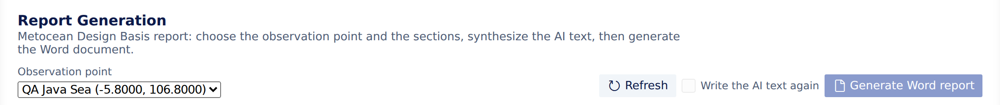

## Detail Proyek

**Detail Proyek** berisi identitas proyek dan pengaturan yang dipakai analisis. Buka dari tampilan **Proyek**, menu di bilah status, atau **Konfersi: Buka Detail Proyek**.

| Tab | Yang diatur |
|---|---|
| **Ringkasan** | Paket, kuota, peran Anda, kolaborator, dan titik di Lab |
| **Identitas** | Nama perusahaan atau entitas, alamat, jenis proyek, lokasi, deskripsi, dan tag. Hanya pemilik proyek yang bisa mengubah identitas |
| **Pemangku Kepentingan** | **Kontak (PIC)**: orang yang bisa dihubungi di pihak klien, sesuai urutan prioritas |
| **Ambang Batas** | Metode nilai ekstrem (**Block Maxima (GEV)** dan/atau **Peaks Over Threshold (GPD)**) dan ambang POT untuk setiap parameter. **Isi Ambang Batas Saran** memberi nilai awal; nilai baru dipakai setelah disimpan |

Pilih **Simpan** (atau **Ctrl+S**/**Cmd+S**). **Buang** memuat ulang versi yang tersimpan. Lab menampilkan siapa yang terakhir memperbarui detail dan kapan.

## Dokumen Perencanaan & Risiko

Di **Konfersi Lab → Perencanaan & Risiko**:

| Dokumen | Isinya |
|---|---|
| **Brief proyek** | Identitas proyek, pemangku kepentingan, dan ambang desain |
| **Operasi & lingkungan** | Urutan operasi kelautan dan batas operabilitasnya, dipakai saat perencanaan |
| **Penilaian risiko** | Bahaya, pengendalian, dan risiko sisa |

Setiap dokumen terbuka di editor. Dokumen diperiksa terhadap skema saat Anda mengetik, jadi kesalahan diberi garis bawah. Simpan dengan **Ctrl+S** (**Cmd+S** di Mac) untuk menyimpannya ke Konfersi; dokumen yang bukan JSON valid tidak disimpan, dan Lab menjelaskan sebabnya.

**Jalankan perencanaan operabilitas** menyimulasikan jendela cuaca untuk operasi yang tersimpan di titik terpilih. Anda membutuhkan minimal satu lingkungan dan satu operasi terlebih dahulu. Untuk alur lengkapnya, lihat [Mission Planning](../using-konfersi/mission-planning.md).

## Membuat laporan

Lab menghasilkan laporan **Metocean Design Basis** sebagai dokumen Word (`.docx`) untuk satu titik observasi. Buka **Pembuatan Laporan** dari bilah aktivitas, daftar alat di menu Lab, atau **Buka Pembuatan Laporan** di Command Palette. Laporan terbuka sebagai tab editor.

1. Pilih **Titik observasi**. Jika proyek belum punya titik, tambahkan dulu di peta.
2. Di **Bagian**, pilih isi laporan. **Semua**, **Hanya yang siap**, dan **Tidak ada** memilih dengan cepat. Lab mengingat pilihan Anda untuk proyek ini.
   Setiap bagian menunjukkan statusnya:
   - **Data siap**, atau belum ada data analisis di titik ini. Proses titiknya terlebih dahulu.
   - **Teks AI siap**, atau teks AI belum disintesis.
   - **Teks standar** (teks tetap) atau **Grafik dari analisis**.
3. Opsional: pilih sebuah bagian lalu **Sintesis dengan AI** agar AI menulis teksnya dari analisis titik tersebut. Baca hasilnya di **Teks bagian**, atau pilih **Buka sebagai Markdown**. **Sintesis ulang** menulis ulang teksnya. Bagian yang belum disintesis tampil di laporan sebagai "Section Not Yet Ready".
4. Opsional: centang **Tulis ulang teks AI**, di samping **Buat laporan Word**, agar AI menulis ulang teks tersimpan dari bagian yang dipilih untuk titik ini. Lihat [Tulis ulang teks AI](#tulis-ulang-teks-ai).
5. Pilih **Buat laporan Word**. Progresnya ditampilkan dan Anda bisa **Batal**. Jika ada bagian yang belum punya data atau teks AI, Lab memberi tahu jumlahnya sebelum menandainya sebagai belum siap di laporan.
6. Setelah **Laporan … sudah siap**, pilih **Unduh** lalu simpan `.docx`-nya.

Laporan sebelumnya ada di **Laporan yang dibuat**; pilih **Unduh .docx** untuk mengunduhnya lagi.

### Tulis ulang teks AI

Lab menyimpan teks tulisan AI untuk setiap bagian di titik tersebut, dan memakainya ulang di laporan berikutnya selama analisis bagian itu tidak berubah. Dengan begitu laporan tetap konsisten dan jatah AI tidak terpakai lagi.

*Bagian atas Pembuatan Laporan (tampilan bahasa Inggris): **Tulis ulang teks AI** (Write the AI text again) ada di antara **Segarkan** (Refresh) dan **Buat laporan Word**, tidak tercentang secara bawaan.*

Centang **Tulis ulang teks AI** jika Anda tetap ingin teks baru, misalnya setelah data titik diambil ulang. Laporan berikutnya yang Anda buat akan menulis ulang teks AI dari bagian yang disertakan:

- Berlaku untuk satu laporan itu saja. Kotaknya tidak tetap tercentang untuk laporan berikutnya.
- Hanya bagian tulisan AI yang ditulis ulang. Teks standar (keterbatasan, ketergantungan, satuan, dan sebagainya) dan teks yang Anda isi sendiri tetap seperti semula.
- Laporannya dihitung satu laporan, seperti biasa, dan penulisan ulang memakai token AI dari jatah proyek seperti sintesis pertama.

Laporan berisi profil proyek, grafik dan tabel dari analisis, serta bagian standar seperti keterbatasan, ketergantungan, dan satuan. Sunting di Word sebelum dibagikan.

<scalar-callout type="warning">Teks yang ditulis AI harus diperiksa oleh orang yang kompeten sebelum diandalkan atau dibagikan. Lihat [penafian AI & metocean](../legal/ai-and-metocean-disclaimer.md).</scalar-callout>
